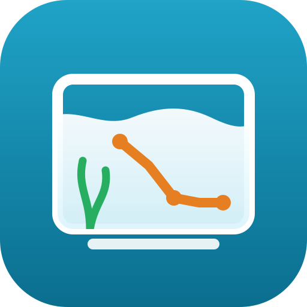

# Aquarium Tracker for Home Assistant

Timeline, reminders and fishless-cycle tracking for aquariums. Data stays local (SQLite in `/config`).

## Install via HACS (recommended)

1. HACS → ⋮ → Custom repositories → add `https://github.com/jagajuda/ha-aquarium-tracker`, type **Integration**.
2. Find **Aquarium Tracker** in HACS → Download.
3. Restart Home Assistant.
4. Settings → Devices & services → Add integration → **Aquarium Tracker** → pick your phone's notify service.
5. Edit `/config/aquarium_tracker/tanks.yaml` (created on first start), then panel → Görevler → "Config'i yeniden yükle".

Updates appear in HACS; download, then restart.

## Install manually (HA OS + Samba)

1. Copy `custom_components/aquarium_tracker/` to `/config/custom_components/aquarium_tracker/`.
2. Copy `aquarium_tracker/tanks.yaml` to `/config/aquarium_tracker/tanks.yaml`
   (if you skip this, a default copy is created on first start).
3. Restart Home Assistant.
4. Settings → Devices & services → Add integration → **Aquarium Tracker** → pick `notify.mobile_app_se3gen`.
5. The **Akvaryum** entry appears in the sidebar (also in the Companion app).

## Files

| Path | Purpose |
|---|---|
| `/config/aquarium_tracker/tanks.yaml` | Tanks, parameters, tasks, schedules, reminders |
| `/config/aquarium_tracker/events.db` | Event log + audit trail + task/mode state (back this up) |

After editing `tanks.yaml`: panel → Görevler → "Config'i yeniden yükle" (or service `aquarium_tracker.reload`).
If the YAML is invalid the integration fails to load and the error is shown in the HA log and in the panel.

## Concepts

- **Event**: everything is an event on one timeline — `measurement`, `dose`, `water_change`, `fertilize`, `note`,
  plus `entity` (auto, from `watch_entities`) and `system` (mode change, cycle complete). Each event's label can be
  toggled on the dashboard.
- **Task**: a reminder bound to an event type. Logging a matching event completes the current occurrence and clears
  the phone notification.
  - `interval`: next due = (date of last matching event + `days`) at `at`.
  - `daily` / `weekly` / `monthly`: fixed slots. An event inside `[slot - early_window_h, next slot - early_window_h)`
    completes that slot. A missed slot stays overdue until the next slot's window opens.
  - `reminder`: first push at due time, then `repeat_count` repeats every `repeat_interval_min` until logged.
    "Ertele" on the notification snoozes for `settings.snooze_min`.
- **Maintenance actions**: per-tank list under `maintenance_actions` (filter clean, glass clean, trimming…).
  Logged with the `maintenance` event type; each action is its own timeline label. A task can reference one
  `action`, or `rotate` through several: the action requested for an occurrence is the one after the last
  rotation action logged before that occurrence's window, and only that action completes it — a skipped week
  never shifts the order. Actions without a task are simply logged.
- **Mode**: `cycling` or `maintenance`, per tank. Tasks run only in their `modes`. Mode is stored in the DB;
  `initial_mode` is only used on first start. Switch from the panel.
- **Cycle**: a dose passes if a measurement within `test_window_h` after it (and before the next dose) shows
  NH4 and NO2 ≤ `zero_threshold`. Untested doses don't break the chain; a non-zero test does.
  `required_passes` consecutive passes → "cycle complete" push; you confirm the switch to maintenance.
  The cycle task asks for NH4 only until NH4 first reads 0, then NH4 + NO2, and switches to `verify_every_days`
  after the first pass.
- **NH4 vs NH3**: kit reading is total ammonia, logged as NH4. If pH (and temp, else `default_temp_c`) is in the same
  measurement, free NH3 is derived (Emerson et al.).
- **Dose**: NH4Cl stock → mg/L NH4 added, computed from `g_per_100ml` and `net_volume_l`.

## Logo

Shown on the integrations page and in HACS on Home Assistant 2026.3 or newer (`custom_components/aquarium_tracker/brand/`).

## Entities

Per tank: `sensor.<tank>_<param>` (latest value, `state_class: measurement` → long-term statistics),
`sensor.<tank>_status` (mode / cycle phase), `sensor.<tank>_next_task` (timestamp).

## Services

`aquarium_tracker.log_event`, `aquarium_tracker.set_mode`, `aquarium_tracker.snooze`, `aquarium_tracker.reload`.

Example (future ESP32 probe automation):

```yaml
action: aquarium_tracker.log_event
data:
  tank: big_tank
  type: measurement
  payload: {values: {pH: "{{ states('sensor.big_tank_ph_probe') }}"}}
```

## Extending

- New single test: add it under `parameters:` (and to a tank's `parameters:` list if that tank restricts them).
- Light on/off etc. on the timeline: add `watch_entities` to a tank (see commented example in `tanks.yaml`).

## Tests

```bash
pip install pytest pyyaml                       # logic tests
pytest tests/test_logic.py
pip install pytest-homeassistant-custom-component home-assistant-frontend   # full HA tests
pytest tests/test_integration.py
```

## Future work

### Live sensors (ESP32: temperature, maybe pH)
Hardware plan: [docs/esp32-controller.md](docs/esp32-controller.md).
Tracker side:
- Map a tank parameter to a live HA sensor in `tanks.yaml` (e.g. `live_sensors: {temp: sensor.big_tank_temperature, pH: sensor.big_tank_ph}`).
- Plot live values as a continuous line in the chart and show them in the value tiles; manual readings stay as points.
- Per-tank threshold alerts (e.g. temperature outside 22–27 °C) through the existing notification system,
  so a stuck heater or a failed one is caught.
- Continuous data stays in HA's recorder/long-term statistics; it does not become timeline events.

### Chihiros light states (B20 nano, B80 big tank)
- Get the lights into HA over Bluetooth with an existing community integration
  ([chihiros-led-control](https://github.com/TheMicDiet/chihiros-led-control) or
  [AquaBle](https://github.com/caleb-venner/AquaBle)); an ESPHome Bluetooth proxy on the ESP32 extends range.
- Log on/off (and possibly brightness changes) on the timeline with `watch_entities`, which already works.
- To verify: whether the light entity follows the light's own built-in schedule (auto mode) or only
  changes made from HA. If only the latter, the photoperiod has to be scheduled from HA for the timeline to be complete.

### Livestock and plant log
- New event types for stocking changes, e.g. `livestock_added` / `livestock_removed` / `plant_added` / `plant_removed`
  with species, count and an optional note (source, price, quarantine).
  A death is a `livestock_removed` with a reason (`died`, `rehomed`, `moved_to:<tank>`).
- Moving livestock or plants between tanks becomes one action that writes a remove on one tank and an add on the other.
- Each tank gets a derived **current inventory** (species → count), computed from the log, so it can be edited the same
  way as any other event (corrections recompute the totals).
- Shown on the dashboard as an inventory card; every change shows up on the timeline with its own label.
- Optional per-tank species list in `tanks.yaml` for one-tap entry (e.g. Neocaridina, Galaxy rasbora, Anubias nana).

### Smaller ideas
- Optional separate toggle for chart lines vs. list filtering if the current split is not enough.
- Value tiles instead of a chart for parameters with a single reading in range.

